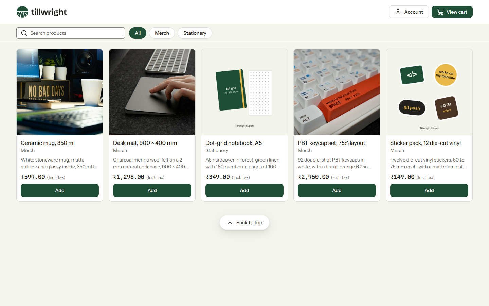
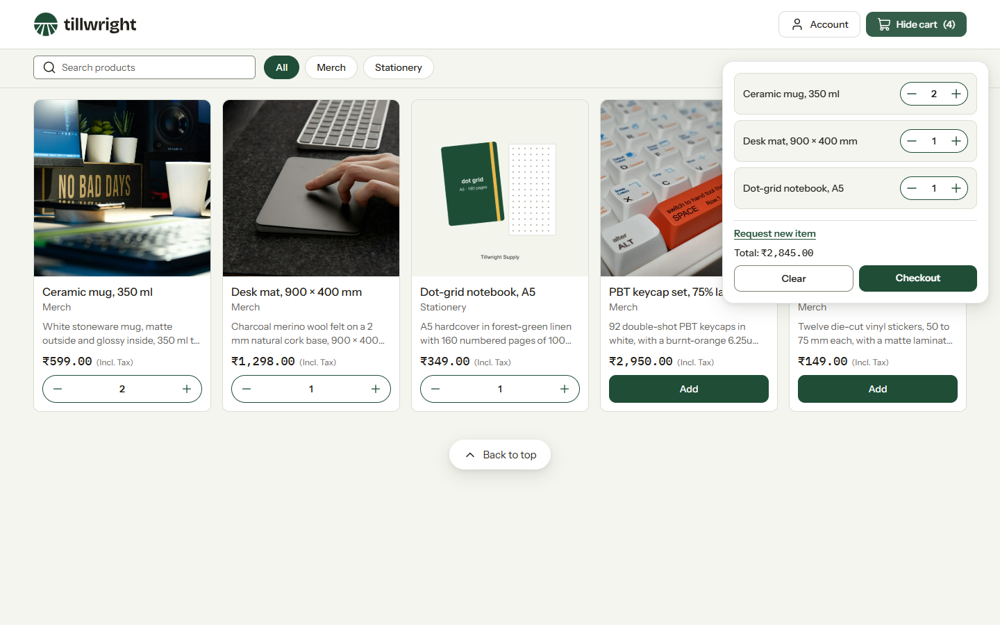
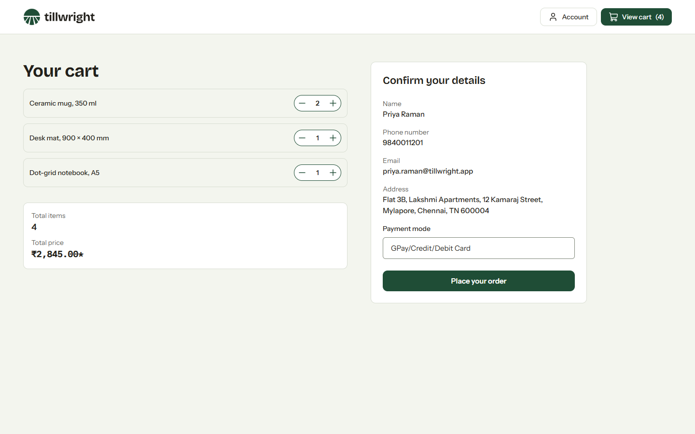
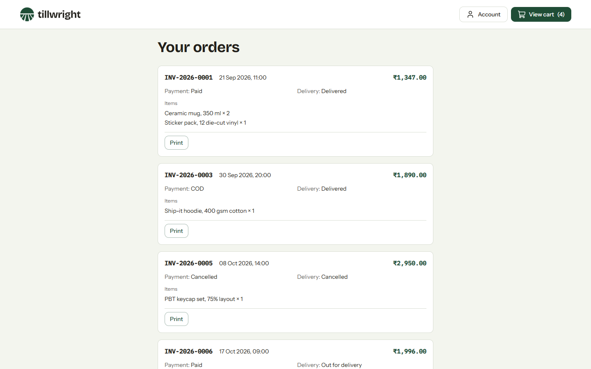
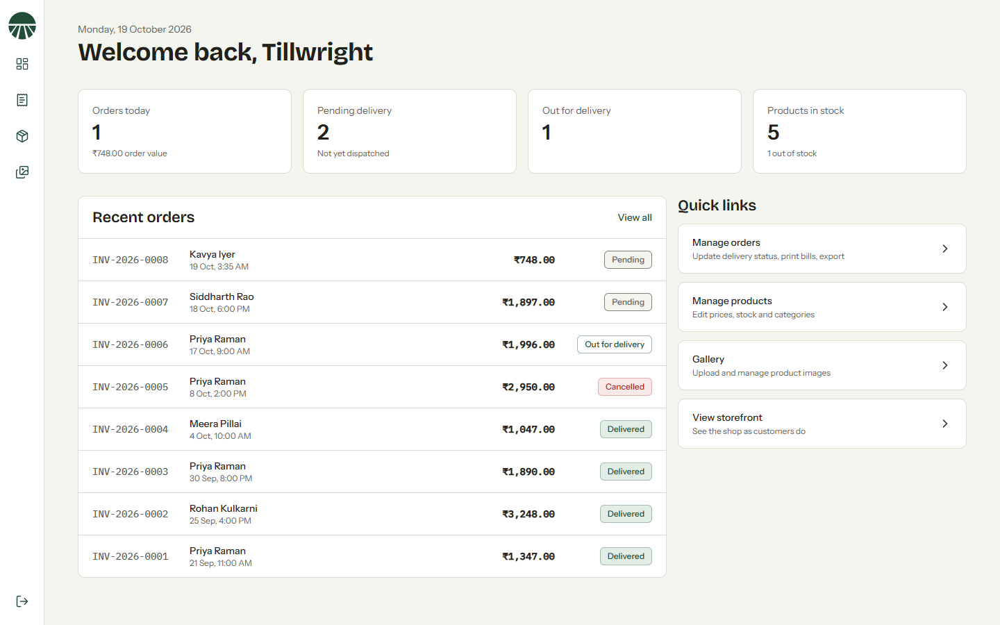
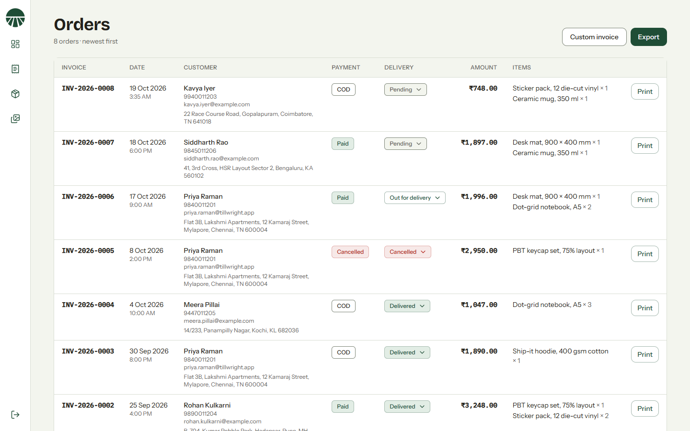
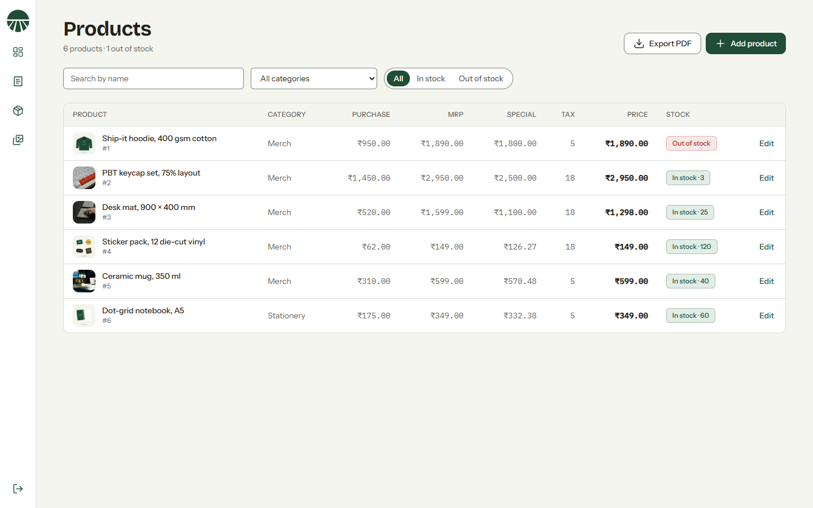
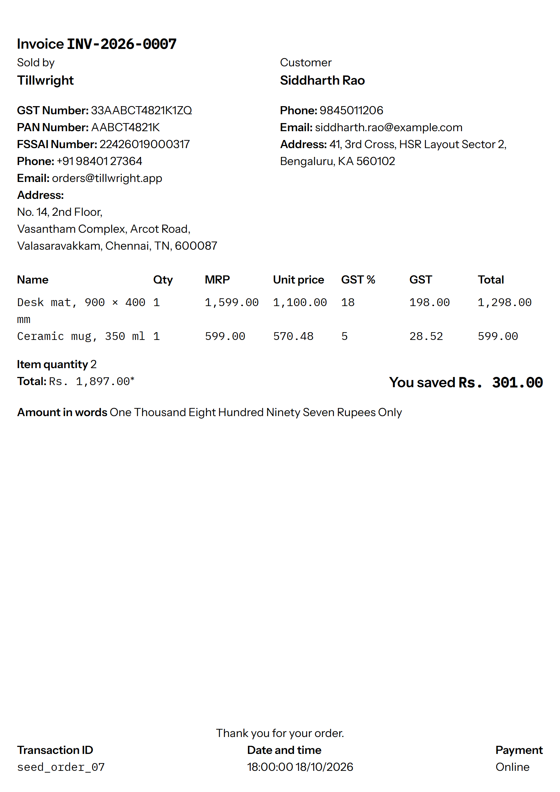
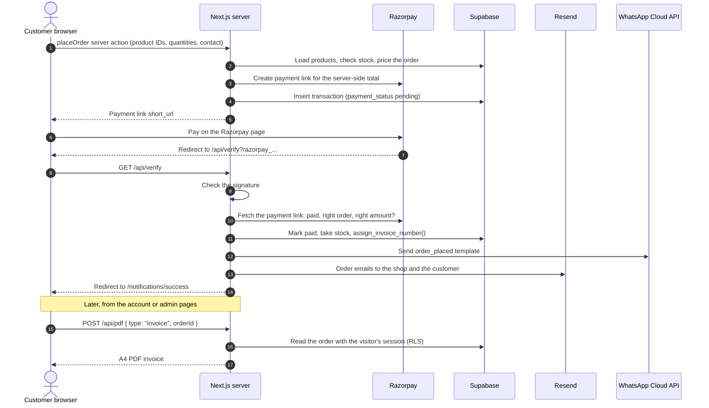

<div align="center">

<picture>
  <source media="(prefers-color-scheme: dark)" srcset="public/brand-docs/assets/Logos/tillwright-wordmark-reverse.svg">
  
</picture>

<h1>Tillwright</h1>

<p><strong>Commerce for your Supabase app.</strong></p>

<p>Products, carts, orders and Razorpay-ready checkout in the database you already have. No second server.</p>

<p><a href="https://tillwright.vercel.app"><strong>Live demo</strong></a> · This is a temporary host. Online payments and emails are off, so check out with cash on delivery.</p>

<p>
  <a href="LICENSE"></a>
  <a href="package.json"></a>
  <a href="https://nextjs.org"></a>
  <a href="https://supabase.com"></a>
</p>

</div>

## Quickstart

```bash
git clone https://github.com/<your-account>/tillwright.git && cd tillwright && npm install
```

Clone and install. You need Node.js 22 or later.

```bash
cp .env.example .env.local
```

Fill in `NEXT_PUBLIC_SUPABASE_URL` and `NEXT_PUBLIC_SUPABASE_PUBLISHABLE_KEY`, plus the seed variables at the bottom of the file: the service role key, the database URL, `SEED_ALLOW=true` and two demo passwords. Razorpay, Resend and WhatsApp keys can wait until you take real orders.

```bash
npm run seed && npm run dev
```

Creates the tables, loads the Tillwright Supply demo store and starts <http://localhost:3000>. Log in as `admin@tillwright.app` to see the admin side. [Full setup](#full-setup) covers each account and key.

## About

Tillwright puts products, carts, orders, checkout and GST invoices in the Supabase Postgres you already run, with Razorpay, cash on delivery and WhatsApp order updates built in for India. It ships with a reference storefront, Tillwright Supply, that you can use as-is, re-skin, or throw away.

- Runs on Next.js and Supabase: no Redis and no separate Node server.
- Razorpay payment links, cash on delivery, and UPI through Razorpay.
- GST invoices and order exports as PDF.
- WhatsApp and email order updates.
- Your data in your own Postgres, open source under MIT.

| Area | Feature | What the code does |
| --- | --- | --- |
| Storefront | Catalogue | Home page lists in-stock products (`inventory <> 0`) from the `products` table, sorted by name. |
| | Search and filter | Searches product names (`ilike`) and filters by category. There are no individual product pages. |
| | Cart | Zustand store kept in `sessionStorage`: add, remove one, remove line, clear, running totals. |
| Auth | Sign up and log in | Supabase email and password. Name, phone and address are saved as user metadata. |
| | Email confirmation | `/auth/confirm` verifies the `token_hash` from the confirmation email and redirects to `next`. |
| | Guest checkout | A checkout form for signed-out visitors. The server saves the details to `guest_profiles` and places the order. |
| Payments | Server-side totals | The `placeOrder` server action receives product IDs and quantities only, then prices the order and checks stock from the database. |
| | Razorpay | `placeOrder` creates a Razorpay **Payment Link** (not an Order) for the server-side total and stores a pending transaction. |
| | Callback | `/api/verify` checks the signature, confirms with Razorpay's API that the link is paid for the right order and amount, then takes stock, assigns the invoice number and sends notifications, once. |
| | Cash on delivery | Reserves stock atomically, saves the order with `payment_status = cod`, and assigns the invoice number. |
| | Result pages | `/notifications/success` (clears the cart) and `/notifications/failure`. |
| Notifications | Email | Resend sends a "new order" email to the shop and a confirmation to the customer, from server code only. |
| | WhatsApp | WhatsApp Cloud API templates: `order_placed` after checkout, `order_dispatched` when an admin updates delivery status. |
| Invoices | PDF invoices | `/api/pdf` renders an order, report or product list from IDs on the server to an A4 PDF with `puppeteer-core` and `@sparticuz/chromium-min`. Customers can print only their own orders. |
| | Bill contents | Shop registrations (GST, PAN, FSSAI), customer details, MRP, unit price, tax rate, tax amount, savings, and the total in words (en-IN). |
| | Custom invoice | Admin can create a one-line invoice for a sale outside the store. It takes the next number in the series. |
| Admin | Dashboard | `/admin` with links to orders and products. Access requires `profiles.role = 'admin'`. |
| | Products | Add and edit products, and upload images to the `productImages` storage bucket. |
| | Gallery | Read-only grid of the images in `productImages`. |
| | Orders | Order list with customer details, a delivery status dropdown and per-order invoice download. Cancelling an order puts its stock back. |
| | Exports | PDF export of orders for a date range and of in-stock products. There is no CSV export. |
| Analytics | Google Analytics | `@next/third-parties` GA tag on every page, plus a `buttonClicked` event when an order is placed. |
| Account | Profile | View and edit name, phone, address and email (Supabase user metadata). |
| | Order history | Orders whose `email` matches the signed-in user, with invoice download. |

## What it doesn't do yet

- No product pages, variants (sizes, colours), digital goods, bundles or gift cards. The items waiting on these are in [docs/seed-roadmap.md](docs/seed-roadmap.md).
- No CSV export, discount codes or shipping rates.
- No "forgot password" form or page to set a new password.
- Admin pages for products and the gallery rely on row-level security, not a server-side check, to stop non-admins.

The full list, with fixes, is in [Known limitations and security notes](#known-limitations-and-security-notes).

## Contents

- [Screenshots](#screenshots)
- [Tech stack](#tech-stack)
- [Architecture](#architecture)
- [Quickstart](#quickstart)
- [What it doesn't do yet](#what-it-doesnt-do-yet)
- [Full setup](#full-setup)
- [Set up your accounts](#set-up-your-accounts)
- [Environment variables](#environment-variables)
- [Database schema](#database-schema)
- [Demo data](#demo-data)
- [Make it yours](#make-it-yours)
- [Project structure](#project-structure)
- [Scripts](#scripts)
- [Deploying to production](#deploying-to-production)
- [Known limitations and security notes](#known-limitations-and-security-notes)
- [Licence and credits](#licence-and-credits)

## Screenshots

Captured from the [demo data](#demo-data). The images are in `public/screenshots/`.

<table>
  <tr>
    <td align="center"><br>Storefront</td>
    <td align="center"><br>Cart</td>
  </tr>
  <tr>
    <td align="center"><br>Checkout</td>
    <td align="center"><br>Order history</td>
  </tr>
  <tr>
    <td align="center"><br>Admin dashboard</td>
    <td align="center"><br>Admin orders</td>
  </tr>
  <tr>
    <td align="center"><br>Admin products</td>
    <td align="center"><br>Invoice</td>
  </tr>
</table>

## Tech stack

Versions are the ones installed from `package-lock.json`.

| Layer | Tool | Why |
| --- | --- | --- |
| Runtime | Node.js 22 or later | Required by `engines` in `package.json`. |
| Framework | Next.js 16.4 (App Router), React 19.3 | Pages, server components, API routes and server actions in one app. |
| Language | TypeScript 5.8 | Types for products, orders and users (`src/utils/types.ts`). |
| Auth and database | Supabase (`@supabase/ssr` 0.5, `@supabase/supabase-js` 2.49) | Email auth, Postgres tables and image storage. |
| Payments | Razorpay Node SDK 2.9 | Payment Links and callback signature helpers. |
| Email | Resend 4.3 | Sends React email components. |
| WhatsApp | WhatsApp Cloud API via `axios` | Order notifications from approved templates. |
| PDF | `puppeteer-core` 25.11, `@sparticuz/chromium-min` 153.0.0 | Headless Chromium that runs in a serverless function. |
| State | Zustand 5.0 | Cart state, persisted in `sessionStorage`. |
| Styling | Tailwind CSS 4.3 | Utility classes, configured in `src/styles/globals.css` (`@theme`). Brand fonts come from Google Fonts. |
| Dates and numbers | `date-fns`, `date-fns-tz`, `to-words` | IST timestamps and amounts in words on invoices. |
| UI helpers | `react-toastify`, `react-datepicker` | Toasts and the date range picker for order exports. |
| Icons | `lucide-react` | Line icons at the brand size and stroke, through `src/ui/Icon`. |
| Analytics | `@next/third-parties` | Google Analytics tag and events. |

## Architecture

How an online order moves through the system. The browser sends only product IDs, quantities and contact details; the server prices the order from the database, and only server code writes orders, invoice numbers and stock.



Cash on delivery skips Razorpay: `placeOrder` reserves stock with `reserve_stock()`, saves the order, assigns the invoice number and sends the same notifications, all on the server.

## Full setup

You need Node.js 22 or later (set in `engines` in `package.json`) and npm. Check with `node -v`.

1. Clone the repository.

   ```bash
   git clone https://github.com/<your-account>/tillwright.git
   cd tillwright
   ```

2. Install dependencies.

   ```bash
   npm install
   ```

3. Copy the example environment file. On Windows Command Prompt, use `copy` instead of `cp`.

   ```bash
   cp .env.example .env.local
   ```

4. Fill in `.env.local` using [Set up your accounts](#set-up-your-accounts). Leave `NEXT_PUBLIC_SITE_URL=http://localhost:3000` for local work.

5. Create the database tables and storage bucket: run [`supabase/schema.sql`](supabase/schema.sql) in the Supabase SQL Editor, or let `npm run seed` do it. See [Database schema](#database-schema).

6. Start the development server.

   ```bash
   npm run dev
   ```

7. Open <http://localhost:3000>. The store is empty until you add products in `/admin/products`, or load the demo store with [Demo data](#demo-data).

> [!NOTE]
> Placing a test order sends real emails and WhatsApp messages if `RESEND_API_KEY` and `WHATSAPP_TOKEN` are set. Leave them unset locally until you want to test notifications.

## Set up your accounts

<details>
<summary><strong>Supabase</strong>: auth, database and image storage</summary>

1. Sign in at <https://supabase.com/dashboard> and create a new project.
2. Open **Project Settings > API** and copy:
   - **Project URL** into `NEXT_PUBLIC_SUPABASE_URL`
   - **Publishable** key (`sb_publishable_...`) into `NEXT_PUBLIC_SUPABASE_PUBLISHABLE_KEY`
3. Open **SQL Editor** and run the schema in [Database schema](#database-schema).
4. Open **Storage**, create a bucket named exactly `productImages`, and mark it **public**. The code reads images with `getPublicUrl`.
5. Open **Authentication > URL Configuration**:
   - Set **Site URL** to your production address, for example `https://www.tillwright.app`.
   - Add `http://localhost:3000/**` and your production `https://www.tillwright.app/**` to **Redirect URLs**.
6. Open **Authentication > Email Templates > Confirm signup**. Point the link at the app's confirm route, which expects `token_hash`, `type` and an optional `next`:

   ```html
   <h2>Confirm your email</h2>
   <p><a href="{{ .SiteURL }}/auth/confirm?token_hash={{ .TokenHash }}&type=email&next=/">Confirm your email address</a></p>
   ```

7. Update `images.remotePatterns` in `next.config.ts` to your own project's hostname (`<project-ref>.supabase.co`). It is currently hard-coded to a different project.

> [!NOTE]
> The code never creates rows in `profiles`, but the admin check reads them. Create a profile row for each admin by hand, or add the trigger in [Database schema](#database-schema).

</details>

<details>
<summary><strong>Razorpay</strong>: online payments</summary>

1. Create an account at <https://dashboard.razorpay.com/signup>.
2. Use the **Test mode** toggle in the dashboard header and keep it on while you build.
3. Open **Account & Settings > API Keys** (in older dashboards, **Settings > API Keys**) and generate a key pair:
   - **Key Id** into `RAZORPAY_KEY_ID`
   - **Key Secret** into `RAZORPAY_KEY_SECRET` (shown once; store it safely)
4. You don't need to register a webhook. The app uses Razorpay's payment-link **callback URL**, which it sets to `${NEXT_PUBLIC_SITE_URL}/api/verify`.
5. Test a payment:
   - UPI: `success@razorpay` succeeds and `failure@razorpay` fails.
   - Cards: use the test cards listed at <https://razorpay.com/docs/payments/payments/test-card-details/>. Any future expiry date and any CVV work.
6. Before you accept real payments, finish KYC in the dashboard, then generate live keys and replace the test keys.

> [!WARNING]
> Test-mode and live-mode keys are separate. Live keys can only be generated after Razorpay activates your account through KYC. Razorpay rejects payment links under ₹1.

</details>

<details>
<summary><strong>Resend</strong>: order emails</summary>

1. Create an account at <https://resend.com/signup>.
2. Open **Domains > Add domain** and add your sending domain, for example `tillwright.app`.
3. Add the DNS records Resend shows (SPF and DKIM, plus DMARC if you want it) at your DNS provider. Wait for the domain status to show **Verified**.
4. Open **API Keys > Create API key** with sending access and copy it into `RESEND_API_KEY`.
5. Set the sender and recipient in `src/utils/siteConfig.ts`. They are not environment variables:
   - `emailFrom`: for example `Tillwright <orders@tillwright.app>`. It must be on the verified domain.
   - `adminEmail`: where "new order" emails go.

</details>

<details>
<summary><strong>WhatsApp Cloud API</strong> (Meta for Developers): order messages</summary>

1. Go to <https://developers.facebook.com/apps>, create an app of type **Business**, and add the **WhatsApp** product.
2. Open **WhatsApp > API Setup**:
   - Copy the **Phone number ID** and build `WHATSAPP_URL` as `https://graph.facebook.com/v20.0/<PHONE_NUMBER_ID>/messages`.
   - Copy the access token into `WHATSAPP_TOKEN`. The temporary token expires after 24 hours. For production, create a **System User** in Meta Business Settings with the `whatsapp_business_messaging` permission and generate a permanent token.
   - While the app is in development, add each recipient's number under **To** so the API will deliver to it.
3. Open **WhatsApp Manager > Message templates** and create these two templates in the **Utility** category, language **English (US)** (`en_US`). The names and body parameter counts must match exactly:

   | Template | Sent when | Body parameters, in order |
   | --- | --- | --- |
   | `order_placed` | After a COD order or a Razorpay callback | `{{1}}` customer name, `{{2}}` invoice number, `{{3}}` delivery date (the code always sends the word `tomorrow`) |
   | `order_dispatched` | Admin sets delivery status to "out for delivery" or "delivered" | `{{1}}` invoice number |

   Example `order_placed` body: `Hi {{1}}, thanks for your order. Invoice {{2}} will reach you {{3}}.`

4. Wait for Meta to approve both templates. Messages that use a template still pending approval fail.
5. Make sure the business phone number has a display name and payment method set up before you go live.

> [!WARNING]
> The code adds `91` to the front of every phone number, so customers must enter a 10-digit Indian mobile number without the country code.

</details>

<details>
<summary><strong>Google Analytics</strong></summary>

1. Go to <https://analytics.google.com>, open **Admin > Create > Property** and create a GA4 property.
2. Add a **Web** data stream for your domain.
3. Copy the stream's **Measurement ID** (`G-XXXXXXXXXX`) into `GA_MEASUREMENT_ID`.

The root layout reads this on the server and writes it into the page, so it is visible to visitors even without the `NEXT_PUBLIC_` prefix. That is fine, because measurement IDs are not secrets.

</details>

<details>
<summary><strong>Vercel</strong>: hosting</summary>

1. Push the repository to GitHub, then import it at <https://vercel.com/new>. Vercel detects Next.js; keep the default build settings. In **Settings > Build and Deployment > Node.js Version**, choose 22.x or later.
2. In **Settings > Environment Variables**, add every variable from [Environment variables](#environment-variables). Set `NEXT_PUBLIC_SITE_URL` to your production address, for example `https://www.tillwright.app`.
3. In **Settings > Domains**, add your domain and create the DNS records Vercel shows.
4. Redeploy after changing any `NEXT_PUBLIC_` variable. Those values are built into the client bundle.
5. PDF generation (`/api/pdf`):
   - On each cold start, `@sparticuz/chromium-min` downloads the Chromium build from GitHub (`chromium-v153.0.0-pack.x64.tar`). The function needs outbound internet access and enough time for the download.
   - If invoices time out or run out of memory, raise the function's max duration and memory in **Settings > Functions**. The route does not set `maxDuration` itself.
   <!-- TODO: confirm the duration and memory /api/pdf needs on Vercel and document the values. -->
   - `@sparticuz/chromium-min` ships a Linux build. Generating PDFs locally on Windows or macOS may fail.
   <!-- TODO: document a local PDF workflow (for example, pointing executablePath at a local Chrome). -->

</details>

## Environment variables

Every variable the code reads. `.env.example` lists the same set with placeholder values.

| Name | Required | Where to get it | Exposure |
| --- | --- | --- | --- |
| `NEXT_PUBLIC_SITE_URL` | Optional. Defaults to `siteConfig.websiteUrl` | Your app's base URL, e.g. `http://localhost:3000` or `https://www.tillwright.app` | Public |
| `NEXT_PUBLIC_SUPABASE_URL` | Required | Supabase **Project Settings > API** | Public |
| `NEXT_PUBLIC_SUPABASE_PUBLISHABLE_KEY` | Required | Supabase **Project Settings > API** | Public (protected by RLS) |
| `RAZORPAY_KEY_ID` | Required for online payments | Razorpay **API Keys** | Server only |
| `RAZORPAY_KEY_SECRET` | Required for online payments | Razorpay **API Keys** | Server only |
| `RESEND_API_KEY` | Required for emails | Resend **API Keys** | Server only |
| `WHATSAPP_URL` | Required for WhatsApp | Meta **WhatsApp > API Setup** (phone number ID) | Server only |
| `WHATSAPP_TOKEN` | Required for WhatsApp | Meta **WhatsApp > API Setup** or a System User token | Server only |
| `CHROME_EXECUTABLE_PATH` | Optional, local only | Path to an installed Chrome, e.g. `C:\Program Files\Google\Chrome\Application\chrome.exe` | Server only. Lets `/api/pdf` work on Windows and macOS; leave unset in production |
| `GA_MEASUREMENT_ID` | Optional | Google Analytics data stream | Read on the server, written into page HTML |
| `SUPABASE_SERVICE_ROLE_KEY` | Required | Supabase **Project Settings > API Keys** (secret key) | Server only. Bypasses RLS. Used by checkout, payment verification, order status changes and `npm run seed` through `src/utils/supabase/admin.ts` |
| `SUPABASE_DB_URL` | Optional, for `npm run seed` | Supabase **Connect > Session pooler** connection string | Server only. Contains the database password. Lets the seed create the tables |
| `SEED_ALLOW` | Only for `npm run seed` | Set to `true` on a development or demo project | Local only |
| `SEED_ADMIN_PASSWORD`, `SEED_CUSTOMER_PASSWORD` | Only for `npm run seed` | Choose your own | Local only |

> [!WARNING]
> Never add the `NEXT_PUBLIC_` prefix to a secret. Next.js copies every `NEXT_PUBLIC_` value into the JavaScript sent to the browser. Keep `.env.local` out of git; `.gitignore` already excludes it.

## Database schema

The code expects four tables and one storage bucket. Column types are inferred from what the code reads and writes, because the repository has no migrations.

<!-- TODO: replace this section with exported migrations from the real database. -->

### `products`

| Column | Type | Required | Notes |
| --- | --- | --- | --- |
| `id` | `bigint` identity | yes | Primary key. Used as the cart line key. |
| `created_at` | `timestamptz` | yes | Defaults to `now()`. |
| `name` | `text` | yes | Searched with `ilike`. |
| `category` | `text` | no | Feeds the category filter. |
| `description` | `text` | no | Two or three sentences, shown on the product card. |
| `image_url` | `text` | no | Public URL from the `productImages` bucket. |
| `purchase` | `numeric` | no | Purchase price ("PP" in admin). Shown only in admin. |
| `mrp` | `numeric` | no | Maximum retail price. Used for "You saved" on invoices. |
| `pretax` | `numeric` | no | Labelled "Special" in admin and "Unit Price" on invoices. |
| `tax` | `numeric` | no | Tax rate as entered. Displayed only; the code does not use it in any calculation. |
| `price` | `numeric` | yes | Selling price, tax included. Used for cart totals. |
| `inventory` | `integer` | no | Products with `0` are hidden from the store. The code does not decrement stock on sale. |

### `transactions`

| Column | Type | Required | Notes |
| --- | --- | --- | --- |
| `id` | `bigint` identity | yes | Primary key. Used for invoices and status updates. |
| `created_at` | `timestamptz` | yes | Defaults to `now()`. Shown in IST. |
| `invoice_id` | `integer` | no | Unique. Assigned by `assign_invoice_number()` from a database sequence: at checkout for COD, after payment for online orders. Shown as `INV-2026-0007`. |
| `transaction_id` | `text` | yes | `nanoid()` reference, `MANUAL-…` for custom invoices, or `seed_…` for demo data. |
| `razorpay_id` | `text` | no | Payment link ID, or `Not Applicable` for COD and custom invoices. |
| `name`, `email`, `phone`, `address` | `text` | no | Customer details. `email` links orders to accounts. |
| `payment_status` | `text` | yes | `pending`, `cod`, `manual` (custom invoices), or the Razorpay link status (for example `paid` or `cancelled`). |
| `delivery_status` | `text` | yes | `pending`, `out for delivery`, `delivered` or `cancelled`. A cancelled order keeps its invoice number, so the series has no gaps for GST filing. |
| `amount` | `numeric` | yes | Order total in rupees. |
| `products` | `jsonb` | yes | Snapshot of each line, taken on the server: the product row as it was, plus `count`. |
| `stock_reserved` | `boolean` | yes | True once the order has taken its items out of stock, so cancelling it knows to put them back. |

### `profiles`

| Column | Type | Required | Notes |
| --- | --- | --- | --- |
| `email` | `text` | yes | Matched against the signed-in user's email. |
| `role` | `text` | yes | `admin` unlocks the admin pages. |

### `guest_profiles`

| Column | Type | Required | Notes |
| --- | --- | --- | --- |
| `name`, `email`, `phone`, `address` | `text` | no | Written by guest checkout. |
| `role` | `text` | no | Always `guest`. |

### Relationships

The code does not enforce any foreign keys. Records are linked by email:

- `transactions.email` = the customer's `auth.users.email` (order history)
- `profiles.email` = `auth.users.email` (admin check)

Storage: a public bucket named `productImages`. Admins upload to it, and `/admin/gallery` lists it.

### Suggested SQL

> [!NOTE]
> Column types are inferred from what the code reads and writes. Test the SQL on a fresh project before you point a live store at it.

The SQL is in [`supabase/schema.sql`](supabase/schema.sql): the four tables, the sign-up trigger, the `is_admin()` helper, the invoice number sequence, the stock functions, RLS policies and storage policies. It is safe to run more than once. It creates whatever is missing (including newer columns on older projects) and replaces functions, triggers and policies, but never drops tables or data. Apply it in either of two ways:

- Paste it into the Supabase **SQL Editor** and run it.
- Set `SUPABASE_DB_URL` and run `npm run seed`, which applies it before loading the demo data. See [Demo data](#demo-data).

How access works:

- **The browser** (publishable key plus the visitor's session) can read products, a customer's own orders and their own profile. Admins can also read all orders, update orders and products, and list and upload product images. Nobody can insert orders or guest details from the browser.
- **The server** uses the service role key (`src/utils/supabase/admin.ts`, which can't be imported into browser code) to place orders, verify payments, assign invoice numbers, move stock and send notifications.
- **Database functions:** `assign_invoice_number(order_id)` hands out the next number from `invoice_number_seq`, once per order. `reserve_stock(items)` takes stock only if every item is available, with the product rows locked, so two checkouts can't both buy the last unit. `adjust_stock(items, direction)` takes or returns stock without checking. Only the service role can call them.

### Make a user an admin

The app treats a signed-in user as an admin when a `profiles` row with the same `email` has `role = 'admin'`. Pages under `/admin` and `/admin/orders` check this on the server; otherwise they redirect to `/auth/login`.

1. Sign up through `/auth/signup` and confirm the email.
2. In the Supabase SQL Editor, run:

   ```sql
   -- With the trigger above, the row already exists:
   update public.profiles set role = 'admin' where email = 'orders@tillwright.app';

   -- Without the trigger, insert it:
   insert into public.profiles (id, email, role)
   select id, email, 'admin' from auth.users where email = 'orders@tillwright.app';
   ```

3. Sign out and back in, then open `/admin`.

## Demo data

`npm run seed` fills a development project with **Tillwright Supply**, a developer merch demo store, so every screen has something to show:

- **Products:** six products, with descriptions, images, GST and margins. They cover out of stock, low stock, on sale, the cheapest item and a second category.
- **Orders:** eight orders over the last 30 days: paid online, COD pending, COD delivered, out for delivery and one cancelled.
- **Accounts:** three demo logins and one guest checkout.

The data lives in `scripts/seed-data.ts`. Six more catalogue items that need features the app doesn't have yet are in [docs/seed-roadmap.md](docs/seed-roadmap.md). Image credits are in [docs/image-credits.md](docs/image-credits.md).

> [!WARNING]
> The seed uses the service role key, which bypasses row-level security. Run it only against a development or demo project, never production.

1. Add these to `.env.local`:

   ```bash
   SUPABASE_SERVICE_ROLE_KEY=sb_secret_...   # Project Settings > API Keys
   SUPABASE_DB_URL=postgresql://...          # Connect > Session pooler; optional
   SEED_ALLOW=true
   SEED_ADMIN_PASSWORD=choose-a-password
   SEED_CUSTOMER_PASSWORD=choose-another-password
   ```

2. Run the seed:

   ```bash
   npm run seed
   ```

   With `SUPABASE_DB_URL` set, it first applies [`supabase/schema.sql`](supabase/schema.sql). Without it, run that file in the SQL Editor first; the seed stops with a message if the tables are missing. It also creates the public `productImages` bucket if it's missing.

Running it again updates the same rows instead of adding more: products match on name, accounts and guests on email, and orders on their `seed_` reference. Orders keep their original dates and invoice numbers, so the invoice series never changes. To remove only the seeded rows, users and images, and nothing else:

```bash
npm run seed -- --reset
```

The seed writes to the database directly and never calls the app's routes, so it sends no emails or WhatsApp messages.

| Login | Role | What you'll see |
| --- | --- | --- |
| `admin@tillwright.app` | Admin | `/admin` dashboard, orders, products and gallery. Password: `SEED_ADMIN_PASSWORD`. |
| `priya.raman@tillwright.app` | Customer | Saved Chennai address and four past orders, one of them cancelled. Password: `SEED_CUSTOMER_PASSWORD`. |
| `arjun.mehta@tillwright.app` | Customer | A brand new account with no orders. Password: `SEED_CUSTOMER_PASSWORD`. |

The guest checkout, Kavya Iyer, has no login. Her COD order appears in `/admin/orders`.

## Make it yours

1. **Store details.** Edit `src/utils/siteConfig.ts`, the single config file. It holds the name, legal name, description, website, logo path, contact email and phone, address lines, support hours, grievance officer, product request form URL, invoice registrations (GST, PAN, FSSAI), email sender, admin email, signature, and policy values. Header, footer, invoices, exports, emails and policy pages all read from it. Example registration: `{ label: "GST Number", value: "33AABCT4821K1ZQ" }`.
2. **Brand.**
   - Fonts: the Google Fonts import and the `--font-*` variables in the `@theme` block of `src/styles/globals.css` (`font-display`, `font-sans`, `font-mono`). PDFs load the same fonts from `src/utils/pdfHead.ts`, so change both.
   - Colours: the brand palette from `public/brand-docs/tokens.json` is mapped into the `@theme` block in `src/styles/globals.css`, so components use utilities such as `bg-surface`, `text-ink` and `bg-field`. To rebrand, change `field`, `rye` and `loam` there. PDFs and emails don't use the theme and keep their own colours.
   - Favicon: `src/app/icon.svg`.
   - Logos: `public/brand-docs/assets/Logos/`. The header uses `siteConfig.wordmarkPath`; the admin sidebar and PDFs use the mark alone, `siteConfig.logoPath`.
   - Icons: [Lucide](https://lucide.dev) through `src/ui/Icon`, which applies the brand size (20px) and stroke (1.75px).
3. **Content.** Edit `src/app/about/page.tsx`, `about/contact`, `about/terms`, `about/privacy`, `about/shipping` and `about/returns`. Most values come from `siteConfig.policies`, but read every page through and have a legal professional review them.
4. **Email copy.** Branded HTML templates for Supabase account emails (sign-up, email change, password reset) and Resend order emails (confirmed, out for delivery, delivered, cancelled, new order for the shop) are in [`email-templates/`](email-templates/README.md), with paste-in steps. The two order emails the app sends today are React components: `src/ui/Components/email-order-place.tsx` (to the shop) and `email-order-confirm.tsx` (to the customer). Subjects are set in `src/utils/orders/notifications.ts`.
5. **WhatsApp copy.** Message text lives in the Meta templates, not in this repository. The template names, language (`en_US`) and parameters are in `src/utils/functions/handleWhatsapp.ts` and `handleDispatchWhatsapp.ts`.
6. **Invoices and tax.** Layout: `src/pdf/templates.tsx` (order and custom invoices, the orders report and the products list). Tax rates are entered per product in admin. The invoice prints the stored rate and works out the tax amount as `(price - pretax) × count`. There is no CGST/SGST/IGST split.
7. **Currency, phone code and locale.** These are hard-coded:
   - Currency `INR`: `src/app/account/checkout/actions.ts`. Also the `₹` and `Rs.` symbols in `src/utils/formatINR.ts` and the PDF templates.
   - Amount in words (`en-IN`, Rupee/Paise): `src/pdf/templates.tsx`.
   - Phone country code `91`: `handleWhatsapp.ts`, `handleDispatchWhatsapp.ts`.
   - Time zone `Asia/Kolkata`: `GenerateBill`, `src/app/account/orders/page.tsx`, `src/app/admin/orders/page.tsx`.
   - Delivery date `"tomorrow"` in the WhatsApp message: `src/utils/functions/whatsappActions.ts`, `src/app/api/verify/route.ts`.
   - HTML `lang="en"`: `src/app/layout.tsx`.

## Project structure

```text
src/
├── app/
│   ├── (homepage)/      Store front: catalogue, search, category filter, cart
│   ├── about/           About, contact, terms, privacy, shipping, returns
│   ├── account/         Checkout (+ actions.ts: placeOrder), order history, profile
│   ├── admin/           Dashboard, orders (+ actions.ts: status, custom invoice), products, gallery
│   ├── api/             verify (Razorpay callback), pdf (invoices and exports)
│   ├── auth/            Login, signup, server actions, email confirm route
│   ├── error/           Shown when an email link or session fails
│   ├── notifications/   Payment success and failure pages
│   ├── icon.svg         Favicon
│   └── layout.tsx       Root layout: global CSS, toasts, Google Analytics
├── pdf/                 PDF templates, HTML documents and the Chromium renderer
├── proxy.ts             Next.js 16 proxy (formerly middleware): Supabase session refresh
├── store/
│   └── cartStore.ts     Cart (Zustand, sessionStorage)
├── styles/
│   └── globals.css      Brand tokens (@theme), fonts, base styles
├── types/
│   └── css.d.ts         CSS module typing
├── ui/                  Components: Header, Footer, Sidebar, CartPanel, ProductCard,
│                        AddProduct, EditProduct, OrderStatus, GenerateBill,
│                        CustomInvoice, ExportOrders, ExportProducts, Icon, emails
└── utils/
    ├── functions/       WhatsApp senders and user helpers
    ├── orders/          Server-only: viewer and admin check, order notifications
    ├── supabase/        Browser, server, middleware and service-role (admin.ts) clients
    ├── downloadPdf.ts   Browser helper that asks /api/pdf for a document
    ├── formatINR.ts     ₹1,299.00 money formatting
    ├── formatInvoiceNo.ts  INV-2026-0007 invoice numbers
    ├── pdfHead.ts       <head> for PDF HTML (fonts, Tailwind CDN)
    ├── siteConfig.ts    Store details, start here
    ├── siteUrl.ts       SITE_URL from NEXT_PUBLIC_SITE_URL
    └── types.ts         Product, Order, User types
```

## Scripts

| Command | What it does |
| --- | --- |
| `npm run dev` | Starts the Next.js development server on <http://localhost:3000>. |
| `npm run build` | Creates a production build. |
| `npm run start` | Serves the production build. Run `build` first. |
| `npm run lint` | Runs ESLint 9 with the flat config in `eslint.config.mjs` (`eslint-config-next`). |
| `npm run seed` | Loads the demo store into a development project. Add `-- --reset` to remove it. See [Demo data](#demo-data). |

## Deploying to production

- [ ] Razorpay KYC is complete and **live** `RAZORPAY_KEY_ID` and `RAZORPAY_KEY_SECRET` are set in Vercel.
- [ ] The Resend domain shows **Verified**, and `siteConfig.emailFrom` uses it.
- [ ] Both WhatsApp templates, `order_placed` and `order_dispatched`, are **approved**, and `WHATSAPP_TOKEN` is a permanent System User token.
- [ ] RLS is enabled on every table and the storage policies are in place. See [Database schema](#database-schema).
- [ ] `NEXT_PUBLIC_SITE_URL` is set to the production address, and the Supabase Site URL and redirect URLs match it.
- [ ] `SUPABASE_SERVICE_ROLE_KEY` is set in Vercel (server only, never with a `NEXT_PUBLIC_` prefix), and `supabase/schema.sql` has been run on the production project.
- [ ] `siteConfig.ts` has your real business details, registrations and grievance officer.
- [ ] `CHROME_EXECUTABLE_PATH` is **not** set in Vercel.
- [ ] The GitHub social preview is uploaded: **Settings > General > Social preview**, using `.github/social-preview.png`.
- [ ] One end-to-end test order for each payment mode: place it, pay, receive both emails and the WhatsApp message, see it in `/admin/orders`, change the delivery status, receive the dispatch message, download the invoice.

## Known limitations and security notes

What's still open. Payment verification, server-side totals, the PDF and email routes, row-level security, invoice numbering, stock and the `/error` page were fixed in this version.

1. **Some admin pages have no server-side check.** `/admin/products` and `/admin/gallery` are client components. The proxy only requires a signed-in user there; row-level security is what stops non-admins from changing products or listing images.
2. **No password reset.** There's no "forgot password" form or page to set a new password, so the reset-password and invite emails in `email-templates/` can't be used yet.
3. **WhatsApp token.** Earlier versions read the token from `NEXT_PUBLIC_WHATSAPP_TOKEN` and sent messages from the browser, which exposed it. It is now `WHATSAPP_TOKEN`, used only on the server. If you deployed an earlier version, rotate the token in Meta Business Settings.
4. **Values are hard-coded** across the code:
    - the `91` phone prefix, `INR`, `Asia/Kolkata` and `"tomorrow"`
    - the Chromium download URL (v153.0.0) in `src/pdf/render.ts`
    - a third-party image resizer link in `AddProduct`
    - Google Fonts and the Tailwind Play CDN loaded into every PDF
5. **Online orders can oversell.** Online orders don't reserve stock at checkout; `/api/verify` takes it only after payment, through `adjust_stock`, which doesn't check availability and stops at 0. If two customers pay for the last unit, both orders go through and inventory shows 0 instead of -1. Cancelling one of them then puts the unit back, so the product shows 1 in stock when there are none.
6. **Other small issues:**
    - Uploading an image whose file name already exists in the bucket fails.
    - The gallery assumes 5-character file extensions such as `.webp`.
    - The success page clears the cart on every render.
    - An unpaid online order stays `pending` with no invoice number; nothing expires it.

## Licence and credits

Released under the [MIT licence](LICENSE).
<!-- TODO: the copyright line in LICENSE has no holder name. Add one. -->

Built by [Lalith Kishore](https://www.lalithkishore.info).
