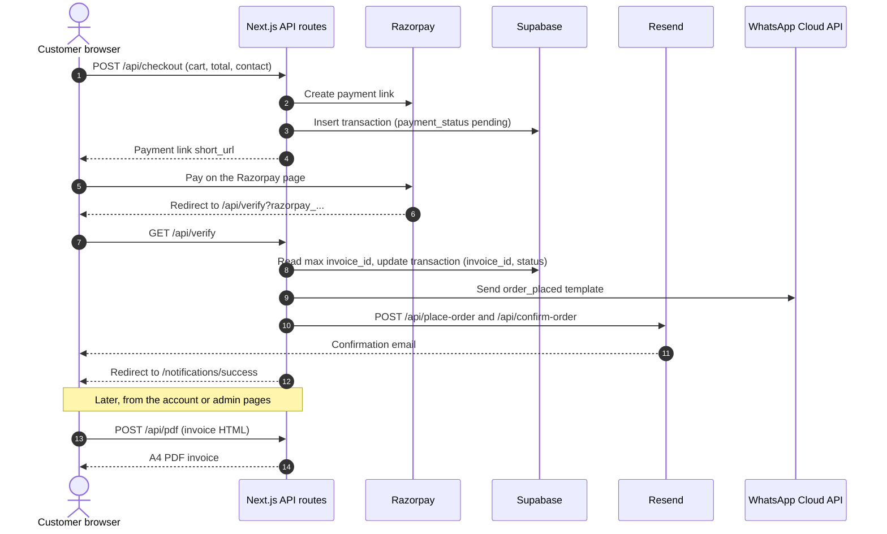

<div align="center">

<picture>
  <source media="(prefers-color-scheme: dark)" srcset="public/brand-docs/assets/tillwright-wordmark-reverse.svg">
  
</picture>

<h1>Tillwright</h1>

<p>Storefronts for growers and small makers.</p>

<p>
  <a href="https://nextjs.org"></a>
  <a href="https://nodejs.org"></a>
  <a href="https://react.dev"></a>
  <a href="https://www.typescriptlang.org"></a>
  <a href="https://supabase.com"></a>
  <a href="https://razorpay.com"></a>
  <a href="https://resend.com"></a>
  <a href="https://tailwindcss.com"></a>
  <a href="LICENSE"></a>
</p>

</div>

## About

Tillwright is a Next.js storefront template for growers and small makers who sell direct to customers in India. It gives you a product catalogue, a basket, Razorpay or cash-on-delivery checkout, order emails and WhatsApp messages, PDF invoices, and a small admin area for products and orders. Customer accounts and data live in Supabase.

| Area | Feature | What the code does |
| --- | --- | --- |
| Storefront | Catalogue | Home page lists in-stock products (`inventory <> 0`) from the `products` table, sorted by name. |
| | Search and filter | Searches product names (`ilike`) and filters by category. There are no individual product pages. |
| | Cart | Zustand store kept in `sessionStorage`: add, remove one, remove line, clear, running totals. |
| Auth | Sign up and log in | Supabase email and password. Name, phone and address are saved as user metadata. |
| | Email confirmation | `/auth/confirm` verifies the `token_hash` from the confirmation email and redirects to `next`. |
| | Guest checkout | A checkout form for signed-out visitors. It writes the details to `guest_profiles`, then places the order. |
| Payments | Razorpay | `/api/checkout` creates a Razorpay **Payment Link** (not an Order) and stores a pending transaction. |
| | Callback | `/api/verify` receives the payment-link callback, sets the invoice number and payment status, and sends notifications. |
| | Cash on delivery | Writes the order straight to `transactions` with `payment_status = cod`. |
| | Result pages | `/notifications/success` (clears the cart) and `/notifications/failure`. |
| Notifications | Email | Resend sends a "new order" email to the shop and a confirmation to the customer, both written as React components. |
| | WhatsApp | WhatsApp Cloud API templates: `order_placed` after checkout, `order_dispatched` when an admin updates delivery status. |
| Invoices | PDF invoices | `/api/pdf` renders HTML to an A4 PDF with `puppeteer-core` and `@sparticuz/chromium-min`. |
| | Bill contents | Shop registrations (GST, PAN, FSSAI), customer details, MRP, unit price, tax rate, tax amount, savings, and the total in words (en-IN). |
| | Custom invoice | Admin can create a one-line "Miscellaneous" invoice with any invoice number and amount. |
| Admin | Dashboard | `/admin` with links to orders and products. Access requires `profiles.role = 'admin'`. |
| | Products | Add and edit products, and upload images to the `productImages` storage bucket. |
| | Gallery | Read-only grid of the images in `productImages`. |
| | Orders | Order list with customer details, a delivery status dropdown and per-order invoice download. |
| | Exports | PDF export of orders for a date range and of in-stock products. There is no CSV export. |
| Analytics | Google Analytics | `@next/third-parties` GA tag on every page, plus a `buttonClicked` event when an order is placed. |
| Account | Profile | View and edit name, phone, address and email (Supabase user metadata). |
| | Order history | Orders whose `email` matches the signed-in user, with invoice download. |

## Contents

- [Screenshots](#screenshots)
- [Tech stack](#tech-stack)
- [Architecture](#architecture)
- [Quick start](#quick-start)
- [Set up your accounts](#set-up-your-accounts)
- [Environment variables](#environment-variables)
- [Database schema](#database-schema)
- [Make it yours](#make-it-yours)
- [Project structure](#project-structure)
- [Scripts](#scripts)
- [Deploying to production](#deploying-to-production)
- [Known limitations and security notes](#known-limitations-and-security-notes)
- [Licence and credits](#licence-and-credits)

## Screenshots

<!-- TODO: add screenshots at these paths. -->

<table>
  <tr>
    <td align="center"><br>Storefront</td>
    <td align="center"><br>Cart</td>
  </tr>
  <tr>
    <td align="center"><br>Checkout</td>
    <td align="center"><br>Admin</td>
  </tr>
  <tr>
    <td align="center" colspan="2"><br>Invoice</td>
  </tr>
</table>

## Tech stack

Versions are the ones installed from `package-lock.json`.

| Layer | Tool | Why |
| --- | --- | --- |
| Runtime | Node.js 22 or later | Required by `engines` in `package.json`. |
| Framework | Next.js 16.4 (App Router), React 19.3 | Pages, server components, API routes and server actions in one app. |
| Language | TypeScript 5.8 | Types for products, orders and users (`src/utils/types.ts`). |
| Auth and database | Supabase (`@supabase/ssr` 0.5, `@supabase/supabase-js` 2.49) | Email auth, Postgres tables and image storage. |
| Payments | Razorpay Node SDK 2.9 | Payment Links and callback signature helpers. |
| Email | Resend 4.3 | Sends React email components. |
| WhatsApp | WhatsApp Cloud API via `axios` | Order notifications from approved templates. |
| PDF | `puppeteer-core` 25.11, `@sparticuz/chromium-min` 153.0.0 | Headless Chromium that runs in a serverless function. |
| State | Zustand 5.0 | Cart state, persisted in `sessionStorage`. |
| Styling | Tailwind CSS 4.3 | Utility classes, configured in `src/styles/globals.css` (`@theme`). Brand fonts come from Google Fonts. |
| Dates and numbers | `date-fns`, `date-fns-tz`, `to-words` | IST timestamps and amounts in words on invoices. |
| UI helpers | `react-toastify`, `react-datepicker` | Toasts and the date range picker for order exports. |
| Analytics | `@next/third-parties` | Google Analytics tag and events. |

## Architecture

How an online order moves through the system. Cash on delivery skips Razorpay: the browser writes the order to Supabase and sends the same notifications directly.



## Quick start

You need Node.js 22 or later (set in `engines` in `package.json`) and npm. Check with `node -v`.

1. Clone the repository.

   ```bash
   git clone https://github.com/<your-account>/tillwright.git
   cd tillwright
   ```

2. Install dependencies.

   ```bash
   npm install
   ```

3. Copy the example environment file. On Windows Command Prompt, use `copy` instead of `cp`.

   ```bash
   cp .env.example .env.local
   ```

4. Fill in `.env.local` using [Set up your accounts](#set-up-your-accounts). Leave `NEXT_PUBLIC_SITE_URL=http://localhost:3000` for local work.

5. Create the database tables and storage bucket. See [Database schema](#database-schema).

6. Start the development server.

   ```bash
   npm run dev
   ```

7. Open <http://localhost:3000>.

> [!NOTE]
> Order emails are sent by the server calling its own `/api/place-order` and `/api/confirm-order` routes at `NEXT_PUBLIC_SITE_URL`. If that variable points to another deployment, your local orders will trigger emails there instead.

## Set up your accounts

<details>
<summary><strong>Supabase</strong>: auth, database and image storage</summary>

1. Sign in at <https://supabase.com/dashboard> and create a new project.
2. Open **Project Settings > API** and copy:
   - **Project URL** into `NEXT_PUBLIC_SUPABASE_URL`
   - **Publishable** key (`sb_publishable_...`) into `NEXT_PUBLIC_SUPABASE_PUBLISHABLE_KEY`
3. Open **SQL Editor** and run the schema in [Database schema](#database-schema).
4. Open **Storage**, create a bucket named exactly `productImages`, and mark it **public**. The code reads images with `getPublicUrl`.
5. Open **Authentication > URL Configuration**:
   - Set **Site URL** to your production address, for example `https://www.tillwright.app`.
   - Add `http://localhost:3000/**` and your production `https://www.tillwright.app/**` to **Redirect URLs**.
6. Open **Authentication > Email Templates > Confirm signup**. Point the link at the app's confirm route, which expects `token_hash`, `type` and an optional `next`:

   ```html
   <h2>Confirm your email</h2>
   <p><a href="{{ .SiteURL }}/auth/confirm?token_hash={{ .TokenHash }}&type=email&next=/">Confirm your email address</a></p>
   ```

7. Update `images.remotePatterns` in `next.config.ts` to your own project's hostname (`<project-ref>.supabase.co`). It is currently hard-coded to a different project.

> [!NOTE]
> The code never creates rows in `profiles`, but the admin check reads them. Create a profile row for each admin by hand, or add the trigger in [Database schema](#database-schema).

</details>

<details>
<summary><strong>Razorpay</strong>: online payments</summary>

1. Create an account at <https://dashboard.razorpay.com/signup>.
2. Use the **Test mode** toggle in the dashboard header and keep it on while you build.
3. Open **Account & Settings > API Keys** (in older dashboards, **Settings > API Keys**) and generate a key pair:
   - **Key Id** into `RAZORPAY_KEY_ID`
   - **Key Secret** into `RAZORPAY_KEY_SECRET` (shown once; store it safely)
4. You don't need to register a webhook. The app uses Razorpay's payment-link **callback URL**, which it sets to `${NEXT_PUBLIC_SITE_URL}/api/verify`.
5. Test a payment:
   - UPI: `success@razorpay` succeeds and `failure@razorpay` fails.
   - Cards: use the test cards listed at <https://razorpay.com/docs/payments/payments/test-card-details/>. Any future expiry date and any CVV work.
6. Before you accept real payments, finish KYC in the dashboard, then generate live keys and replace the test keys.

> [!WARNING]
> Test-mode and live-mode keys are separate. Live keys can only be generated after Razorpay activates your account through KYC. Razorpay rejects payment links under ₹1.

</details>

<details>
<summary><strong>Resend</strong>: order emails</summary>

1. Create an account at <https://resend.com/signup>.
2. Open **Domains > Add domain** and add your sending domain, for example `tillwright.app`.
3. Add the DNS records Resend shows (SPF and DKIM, plus DMARC if you want it) at your DNS provider. Wait for the domain status to show **Verified**.
4. Open **API Keys > Create API key** with sending access and copy it into `RESEND_API_KEY`.
5. Set the sender and recipient in `src/utils/siteConfig.ts`. They are not environment variables:
   - `emailFrom`: for example `Tillwright <orders@tillwright.app>`. It must be on the verified domain.
   - `adminEmail`: where "new order" emails go.

</details>

<details>
<summary><strong>WhatsApp Cloud API</strong> (Meta for Developers): order messages</summary>

1. Go to <https://developers.facebook.com/apps>, create an app of type **Business**, and add the **WhatsApp** product.
2. Open **WhatsApp > API Setup**:
   - Copy the **Phone number ID** and build `WHATSAPP_URL` as `https://graph.facebook.com/v20.0/<PHONE_NUMBER_ID>/messages`.
   - Copy the access token into `WHATSAPP_TOKEN`. The temporary token expires after 24 hours. For production, create a **System User** in Meta Business Settings with the `whatsapp_business_messaging` permission and generate a permanent token.
   - While the app is in development, add each recipient's number under **To** so the API will deliver to it.
3. Open **WhatsApp Manager > Message templates** and create these two templates in the **Utility** category, language **English (US)** (`en_US`). The names and body parameter counts must match exactly:

   | Template | Sent when | Body parameters, in order |
   | --- | --- | --- |
   | `order_placed` | After a COD order or a Razorpay callback | `{{1}}` customer name, `{{2}}` invoice number, `{{3}}` delivery date (the code always sends the word `tomorrow`) |
   | `order_dispatched` | Admin sets delivery status to "out for delivery" or "delivered" | `{{1}}` invoice number |

   Example `order_placed` body: `Hi {{1}}, thanks for your order. Invoice {{2}} will reach you {{3}}.`

4. Wait for Meta to approve both templates. Messages that use a template still pending approval fail.
5. Make sure the business phone number has a display name and payment method set up before you go live.

> [!WARNING]
> The code adds `91` to the front of every phone number, so customers must enter a 10-digit Indian mobile number without the country code.

</details>

<details>
<summary><strong>Google Analytics</strong></summary>

1. Go to <https://analytics.google.com>, open **Admin > Create > Property** and create a GA4 property.
2. Add a **Web** data stream for your domain.
3. Copy the stream's **Measurement ID** (`G-XXXXXXXXXX`) into `GA_MEASUREMENT_ID`.

The root layout reads this on the server and writes it into the page, so it is visible to visitors even without the `NEXT_PUBLIC_` prefix. That is fine, because measurement IDs are not secrets.

</details>

<details>
<summary><strong>Vercel</strong>: hosting</summary>

1. Push the repository to GitHub, then import it at <https://vercel.com/new>. Vercel detects Next.js; keep the default build settings. In **Settings > Build and Deployment > Node.js Version**, choose 22.x or later.
2. In **Settings > Environment Variables**, add every variable from [Environment variables](#environment-variables). Set `NEXT_PUBLIC_SITE_URL` to your production address, for example `https://www.tillwright.app`.
3. In **Settings > Domains**, add your domain and create the DNS records Vercel shows.
4. Redeploy after changing any `NEXT_PUBLIC_` variable. Those values are built into the client bundle.
5. PDF generation (`/api/pdf`):
   - On each cold start, `@sparticuz/chromium-min` downloads the Chromium build from GitHub (`chromium-v153.0.0-pack.x64.tar`). The function needs outbound internet access and enough time for the download.
   - If invoices time out or run out of memory, raise the function's max duration and memory in **Settings > Functions**. The route does not set `maxDuration` itself.
   <!-- TODO: confirm the duration and memory /api/pdf needs on Vercel and document the values. -->
   - `@sparticuz/chromium-min` ships a Linux build. Generating PDFs locally on Windows or macOS may fail.
   <!-- TODO: document a local PDF workflow (for example, pointing executablePath at a local Chrome). -->

</details>

## Environment variables

Every variable the code reads. `.env.example` lists the same set with placeholder values.

| Name | Required | Where to get it | Exposure |
| --- | --- | --- | --- |
| `NEXT_PUBLIC_SITE_URL` | Optional. Defaults to `siteConfig.websiteUrl` | Your app's base URL, e.g. `http://localhost:3000` or `https://www.tillwright.app` | Public |
| `NEXT_PUBLIC_SUPABASE_URL` | Required | Supabase **Project Settings > API** | Public |
| `NEXT_PUBLIC_SUPABASE_PUBLISHABLE_KEY` | Required | Supabase **Project Settings > API** | Public (protected by RLS) |
| `RAZORPAY_KEY_ID` | Required for online payments | Razorpay **API Keys** | Server only |
| `RAZORPAY_KEY_SECRET` | Required for online payments | Razorpay **API Keys** | Server only |
| `RESEND_API_KEY` | Required for emails | Resend **API Keys** | Server only |
| `WHATSAPP_URL` | Required for WhatsApp | Meta **WhatsApp > API Setup** (phone number ID) | Server only |
| `WHATSAPP_TOKEN` | Required for WhatsApp | Meta **WhatsApp > API Setup** or a System User token | Server only |
| `GA_MEASUREMENT_ID` | Optional | Google Analytics data stream | Read on the server, written into page HTML |

> [!WARNING]
> Never add the `NEXT_PUBLIC_` prefix to a secret. Next.js copies every `NEXT_PUBLIC_` value into the JavaScript sent to the browser. Keep `.env.local` out of git; `.gitignore` already excludes it.

## Database schema

The code expects four tables and one storage bucket. Column types are inferred from what the code reads and writes, because the repository has no migrations.

<!-- TODO: replace this section with exported migrations from the real database. -->

### `products`

| Column | Type | Required | Notes |
| --- | --- | --- | --- |
| `id` | `bigint` identity | yes | Primary key. Used as the cart line key. |
| `created_at` | `timestamptz` | yes | Defaults to `now()`. |
| `name` | `text` | yes | Searched with `ilike`. |
| `category` | `text` | no | Feeds the category filter. |
| `image_url` | `text` | no | Public URL from the `productImages` bucket. |
| `purchase` | `numeric` | no | Purchase price ("PP" in admin). Shown only in admin. |
| `mrp` | `numeric` | no | Maximum retail price. Used for "You saved" on invoices. |
| `pretax` | `numeric` | no | Labelled "Special" in admin and "Unit Price" on invoices. |
| `tax` | `numeric` | no | Tax rate as entered. Displayed only; the code does not use it in any calculation. |
| `price` | `numeric` | yes | Selling price, tax included. Used for cart totals. |
| `inventory` | `integer` | no | Products with `0` are hidden from the store. The code does not decrement stock on sale. |

### `transactions`

| Column | Type | Required | Notes |
| --- | --- | --- | --- |
| `id` | `bigint` identity | yes | Primary key. Used for invoices and status updates. |
| `created_at` | `timestamptz` | yes | Defaults to `now()`. Shown in IST. |
| `invoice_id` | `integer` | no | Set for COD at checkout, and for online orders in `/api/verify`. Computed as max + 1. |
| `transaction_id` | `text` | yes | `nanoid()` reference, or `MANUAL` for custom invoices, so it is not unique. |
| `razorpay_id` | `text` | no | Payment link ID, or `Not Applicable` for COD and custom invoices. |
| `name`, `email`, `phone`, `address` | `text` | no | Customer details. `email` links orders to accounts. |
| `payment_status` | `text` | yes | `pending`, `cod`, or the Razorpay link status (for example `paid`). |
| `delivery_status` | `text` | yes | `pending`, `out for delivery` or `delivered`. |
| `amount` | `numeric` | yes | Order total in rupees. |
| `products` | `jsonb` | yes | Snapshot of each cart line: the full product row plus `count`. |

### `profiles`

| Column | Type | Required | Notes |
| --- | --- | --- | --- |
| `email` | `text` | yes | Matched against the signed-in user's email. |
| `role` | `text` | yes | `admin` unlocks the admin pages. |

### `guest_profiles`

| Column | Type | Required | Notes |
| --- | --- | --- | --- |
| `name`, `email`, `phone`, `address` | `text` | no | Written by guest checkout. |
| `role` | `text` | no | Always `guest`. |

### Relationships

The code does not enforce any foreign keys. Records are linked by email:

- `transactions.email` = the customer's `auth.users.email` (order history)
- `profiles.email` = `auth.users.email` (admin check)

Storage: a public bucket named `productImages`. Admins upload to it, and `/admin/gallery` lists it.

### Suggested SQL

> [!WARNING]
> This is a suggested starting point, not the schema of a running store. Test it on a fresh project first. The stricter RLS policies below **break parts of the current code**: see the list after the SQL.

```sql
-- Tables ------------------------------------------------------------------

create table public.products (
  id          bigint generated by default as identity primary key,
  created_at  timestamptz not null default now(),
  name        text not null,
  category    text,
  image_url   text,
  purchase    numeric,
  mrp         numeric,
  pretax      numeric,
  tax         numeric,
  price       numeric not null,
  inventory   integer default 0
);

create table public.transactions (
  id               bigint generated by default as identity primary key,
  created_at       timestamptz not null default now(),
  invoice_id       integer unique,
  transaction_id   text not null,
  razorpay_id      text,
  name             text,
  email            text,
  phone            text,
  address          text,
  payment_status   text not null,
  delivery_status  text not null default 'pending',
  amount           numeric not null,
  products         jsonb not null default '[]'::jsonb
);
create index on public.transactions (transaction_id);
create index on public.transactions (email);

-- id is not used by the code; it ties each profile to its auth user.
create table public.profiles (
  id     uuid primary key references auth.users (id) on delete cascade,
  email  text not null unique,
  role   text not null default 'customer'
);

create table public.guest_profiles (
  id          bigint generated by default as identity primary key,
  created_at  timestamptz not null default now(),
  name        text,
  email       text,
  phone       text,
  address     text,
  role        text default 'guest'
);

-- Create a profile row for every new sign-up (not in the app code).
create or replace function public.handle_new_user()
returns trigger language plpgsql security definer set search_path = public as $$
begin
  insert into public.profiles (id, email) values (new.id, new.email);
  return new;
end;
$$;

create trigger on_auth_user_created
  after insert on auth.users
  for each row execute function public.handle_new_user();

-- Admin helper, mirroring the app's check (profiles.role = 'admin' by email).
create or replace function public.is_admin()
returns boolean language sql stable security definer set search_path = public as $$
  select exists (
    select 1 from public.profiles
    where email = auth.jwt() ->> 'email' and role = 'admin'
  );
$$;

-- Row-level security ------------------------------------------------------

alter table public.products        enable row level security;
alter table public.transactions    enable row level security;
alter table public.profiles        enable row level security;
alter table public.guest_profiles  enable row level security;

-- Products: anyone reads, only admins write.
create policy "products are public" on public.products
  for select using (true);
create policy "admins insert products" on public.products
  for insert to authenticated with check (public.is_admin());
create policy "admins update products" on public.products
  for update to authenticated using (public.is_admin()) with check (public.is_admin());

-- Transactions: customers see only their own orders, admins see and update all.
create policy "anyone places an order" on public.transactions
  for insert to anon, authenticated with check (true);
create policy "customers read own orders" on public.transactions
  for select to authenticated
  using (email = auth.jwt() ->> 'email' or public.is_admin());
create policy "admins update orders" on public.transactions
  for update to authenticated using (public.is_admin()) with check (public.is_admin());

-- Profiles: users read their own row. Roles are changed only from the SQL editor.
create policy "read own profile" on public.profiles
  for select to authenticated using (email = auth.jwt() ->> 'email');

-- Guest profiles: anyone inserts, only admins read.
create policy "anyone adds guest details" on public.guest_profiles
  for insert to anon, authenticated with check (true);
create policy "admins read guest details" on public.guest_profiles
  for select to authenticated using (public.is_admin());

-- Storage: public reads, admin-only uploads to productImages.
create policy "admins upload product images" on storage.objects
  for insert to authenticated
  with check (bucket_id = 'productImages' and public.is_admin());
```

These parts of the current code depend on looser access and will fail under the policies above:

- `fetchInvoiceNumber` runs with the customer's session and reads the highest `invoice_id` across **all** orders. With the policies above it only sees the customer's own orders, so invoice numbers repeat.
- `/api/verify` uses the browser Supabase client on the server with no session (role `anon`) to update and read the order.
- `/api/place-order` and `/api/confirm-order` are called server to server without cookies, so they read `transactions` as `anon`.
- Guest orders: `notifyOrderPlaced` reads the order as the visitor, who is `anon` and cannot select it.

The recommended fix is to give those server paths a separate, server-only Supabase client using the service role key, and to generate invoice numbers in the database (a sequence or a trigger). Until then, you would need to grant `anon` select and update on `transactions`, which exposes every order to anyone holding the anon key.
<!-- TODO: update the policies once server routes use a service-role client. -->

### Make a user an admin

The app treats a signed-in user as an admin when a `profiles` row with the same `email` has `role = 'admin'`. Pages under `/admin` and `/admin/orders` check this on the server; otherwise they redirect to `/auth/login`.

1. Sign up through `/auth/signup` and confirm the email.
2. In the Supabase SQL Editor, run:

   ```sql
   -- With the trigger above, the row already exists:
   update public.profiles set role = 'admin' where email = 'orders@tillwright.app';

   -- Without the trigger, insert it:
   insert into public.profiles (id, email, role)
   select id, email, 'admin' from auth.users where email = 'orders@tillwright.app';
   ```

3. Sign out and back in, then open `/admin`.

## Make it yours

1. **Store details.** Edit `src/utils/siteConfig.ts`, the single config file. It holds the name, legal name, description, website, logo path, contact email and phone, address lines, support hours, grievance officer, product request form URL, invoice registrations (GST, PAN, FSSAI), email sender, admin email, signature, and policy values. Header, footer, invoices, exports, emails and policy pages all read from it. Example registration: `{ label: "GST Number", value: "33AABCT4821K1ZQ" }`.
2. **Brand.**
   - Fonts: the Google Fonts import and the `--font-*` variables in the `@theme` block of `src/styles/globals.css` (`font-display`, `font-sans`, `font-mono`). PDFs load the same fonts from `src/utils/pdfHead.ts`, so change both.
   - Colours: the brand palette (field green `#1F4D36`, rye gold `#E9B949`, loam `#4A3324`) is defined in `public/brand-docs/tokens.json`, but the `@theme` block in `src/styles/globals.css` does not use it yet. The UI still uses Tailwind defaults such as `bg-lime-400` and `bg-slate-600` directly in components under `src/ui/`.
     <!-- TODO: map tokens.json into the @theme block in globals.css and replace the hard-coded lime/slate classes. -->
   - Favicon: `src/app/icon.svg`.
   - Logos: `public/brand-docs/assets/`. The path the app uses is `siteConfig.logoPath`.
3. **Content.** Edit `src/app/about/page.tsx`, `about/contact`, `about/terms`, `about/privacy`, `about/shipping` and `about/returns`. Most values come from `siteConfig.policies`, but read every page through and have a legal professional review them.
4. **Email copy.** Edit `src/ui/Components/email-order-place.tsx` (to the shop) and `email-order-confirm.tsx` (to the customer). Subjects are set in `src/app/api/place-order/route.ts` and `src/app/api/confirm-order/route.ts`.
5. **WhatsApp copy.** Message text lives in the Meta templates, not in this repository. The template names, language (`en_US`) and parameters are in `src/utils/functions/handleWhatsapp.ts` and `handleDispatchWhatsapp.ts`.
6. **Invoices and tax.** Layout: `src/ui/GenerateBill/index.tsx` (order invoices), `src/ui/CustomInvoice/index.tsx` (manual invoices), `src/ui/ExportOrders` and `src/ui/ExportProducts` (exports). Tax rates are entered per product in admin. The invoice prints the stored rate and works out the tax amount as `(price - pretax) × count`. There is no CGST/SGST/IGST split.
7. **Currency, phone code and locale.** These are hard-coded:
   - Currency `INR`: `src/app/api/checkout/route.ts`. Also the `₹` and `Rs.` symbols in components.
   - Amount in words (`en-IN`, Rupee/Paise): `GenerateBill` and `CustomInvoice`.
   - Phone country code `91`: `handleWhatsapp.ts`, `handleDispatchWhatsapp.ts`.
   - Time zone `Asia/Kolkata`: `GenerateBill`, `src/app/account/orders/page.tsx`, `src/app/admin/orders/page.tsx`.
   - Delivery date `"tomorrow"` in the WhatsApp message: `src/utils/functions/whatsappActions.ts`, `src/app/api/verify/route.ts`.
   - HTML `lang="en"`: `src/app/layout.tsx`.

## Project structure

```text
src/
├── app/
│   ├── (homepage)/      Store front: catalogue, search, category filter, cart
│   ├── about/           About, contact, terms, privacy, shipping, returns
│   ├── account/         Checkout (+ actions.ts), order history, profile
│   ├── admin/           Dashboard, orders, products, gallery (admin only)
│   ├── api/             checkout, verify, place-order, confirm-order, pdf
│   ├── auth/            Login, signup, server actions, email confirm route
│   ├── notifications/   Payment success and failure pages
│   ├── icon.svg         Favicon
│   └── layout.tsx       Root layout: global CSS, toasts, Google Analytics
├── proxy.ts             Next.js 16 proxy (formerly middleware): Supabase session refresh
├── store/
│   ├── cartStore.ts     Cart (Zustand, sessionStorage)
│   ├── counterStore.ts  Unused
│   └── searchText.ts    Unused
├── styles/
│   └── globals.css      Fonts, CSS variables, base styles
├── types/
│   └── css.d.ts         CSS module typing
├── ui/                  Components: Header, Footer, Sidebar, Cart, ProductCard,
│                        AddProduct, EditProduct, OrderStatus, GenerateBill,
│                        CustomInvoice, ExportOrders, ExportProducts, emails
└── utils/
    ├── functions/       Email, WhatsApp, invoice number, user helpers
    ├── middleware/      cors.ts (unused)
    ├── supabase/        Browser, server and middleware clients
    ├── pdfHead.ts       <head> for PDF HTML (fonts, Tailwind CDN)
    ├── siteConfig.ts    Store details, start here
    ├── siteUrl.ts       SITE_URL from NEXT_PUBLIC_SITE_URL
    └── types.ts         Product, Order, User types
```

## Scripts

| Command | What it does |
| --- | --- |
| `npm run dev` | Starts the Next.js development server on <http://localhost:3000>. |
| `npm run build` | Creates a production build. |
| `npm run start` | Serves the production build. Run `build` first. |
| `npm run lint` | Runs ESLint 9 with the flat config in `eslint.config.mjs` (`eslint-config-next`). |

## Deploying to production

- [ ] Razorpay KYC is complete and **live** `RAZORPAY_KEY_ID` and `RAZORPAY_KEY_SECRET` are set in Vercel.
- [ ] The Resend domain shows **Verified**, and `siteConfig.emailFrom` uses it.
- [ ] Both WhatsApp templates, `order_placed` and `order_dispatched`, are **approved**, and `WHATSAPP_TOKEN` is a permanent System User token.
- [ ] RLS is enabled on every table and the storage policies are in place. See [Database schema](#database-schema).
- [ ] `NEXT_PUBLIC_SITE_URL` is set to the production address, and the Supabase Site URL and redirect URLs match it.
- [ ] `next.config.ts` `images.remotePatterns` points at your own Supabase project.
- [ ] `siteConfig.ts` has your real business details, registrations and grievance officer.
- [ ] The security issues in [Known limitations](#known-limitations-and-security-notes) are fixed, especially payment verification and the client-supplied total.
- [ ] One end-to-end test order for each payment mode: place it, pay, receive both emails and the WhatsApp message, see it in `/admin/orders`, change the delivery status, receive the dispatch message, download the invoice.

## Known limitations and security notes

Found while reading the code. The code has **not** been changed for any of these.

> [!WARNING]
> Fix the first three before you take real payments.

1. **The Razorpay signature is not enforced.** `/api/verify` calls `validatePaymentVerification` but ignores its return value, and the `finally` block always redirects to the success page. Anyone can call `/api/verify` with made-up query parameters (for example `razorpay_payment_link_status=paid`), and the order will be marked paid and notifications sent. Fix: stop when the function returns `false`, and confirm the payment link status with the Razorpay API.
2. **The order total comes from the browser.** `/api/checkout` charges `totalPrice` as sent by the client, and COD orders store the client's `amount` and `products`. Fix: recompute the total on the server from product IDs and current `products.price`.
3. **`/api/pdf` is open to anyone.** It renders any HTML it receives in Chromium with `--disable-web-security`, and `next.config.ts` sends `Access-Control-Allow-Origin: *` for every `/api` route. That can be abused for server-side requests and compute. Fix: require a signed-in user (or admin), render invoices from an order ID on the server rather than accepting HTML, and restrict CORS.
4. **Email routes are open.** Anyone who knows a `transaction_id` can call `/api/place-order` and `/api/confirm-order` to trigger emails. Fix: call the email functions directly from server code instead of through public routes.
5. **Database access from the server relies on loose RLS.** See the list after [Suggested SQL](#suggested-sql). Fix: use a server-only service-role client for those paths.
6. **Invoice numbers can collide.** They are computed as max + 1 in application code, so two orders placed at the same moment can get the same number. Custom invoices accept any number the admin types. Fix: use a database sequence.
7. **Some admin pages have no server-side check.** `/admin/products` and `/admin/gallery` are client components. Only RLS stops non-admins from changing products.
8. **`/error` does not exist.** `/auth/confirm` and `logout` redirect there on failure.
9. **The failure page is rarely reached.** `/api/verify` always ends on `/notifications/success`, whatever the payment status. Separately, if Razorpay rejects the amount as too small, `/api/checkout` sends a 307 redirect to `/notifications/failure`, which the browser's `fetch` follows silently.
10. **WhatsApp token.** Earlier versions read the token from `NEXT_PUBLIC_WHATSAPP_TOKEN` and sent messages from the browser, which exposed it. It is now `WHATSAPP_TOKEN`, used only in server actions and routes. If you deployed an earlier version, rotate the token in Meta Business Settings.
11. **Values are hard-coded** across the code:
    - the `91` phone prefix, `INR`, `Asia/Kolkata` and `"tomorrow"`
    - a specific Supabase hostname in `next.config.ts`
    - the Chromium download URL (v153.0.0) in `/api/pdf`
    - `http://localhost:3000` in `src/utils/middleware/cors.ts` and `src/app/api/_middleware.ts` (neither file is used)
    - a third-party image resizer link in `AddProduct`
    - Google Fonts and the Tailwind Play CDN loaded into every PDF
12. **Other small issues:**
    - Inventory is never decremented on sale.
    - The customer confirmation email greets the customer by email address.
    - Uploading an image whose file name already exists in the bucket fails.
    - The gallery assumes 5-character file extensions such as `.webp`.
    - The success page clears the cart on every render.
    - Setting a delivery status to "delivered" also sends the `order_dispatched` message.
13. **Unused code and dependencies:**
    - `sassOptions` in `next.config.ts` (Sass is not installed)
    - `src/store/counterStore.ts` and `src/store/searchText.ts`
    - `src/ui/Components/email-template.tsx`
    - the `description` field on the `Product` type

## Licence and credits

Released under the [MIT licence](LICENSE).
<!-- TODO: the copyright line in LICENSE has no holder name. Add one. -->

Built by [Lalith Kishore](https://www.lalithkishore.info).
